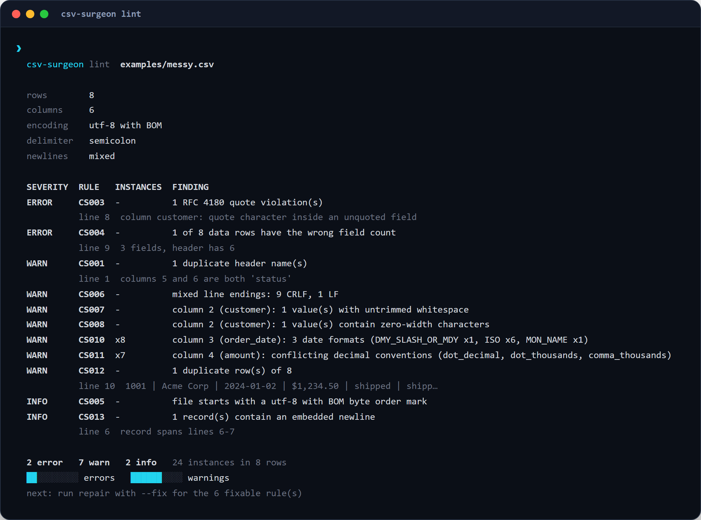
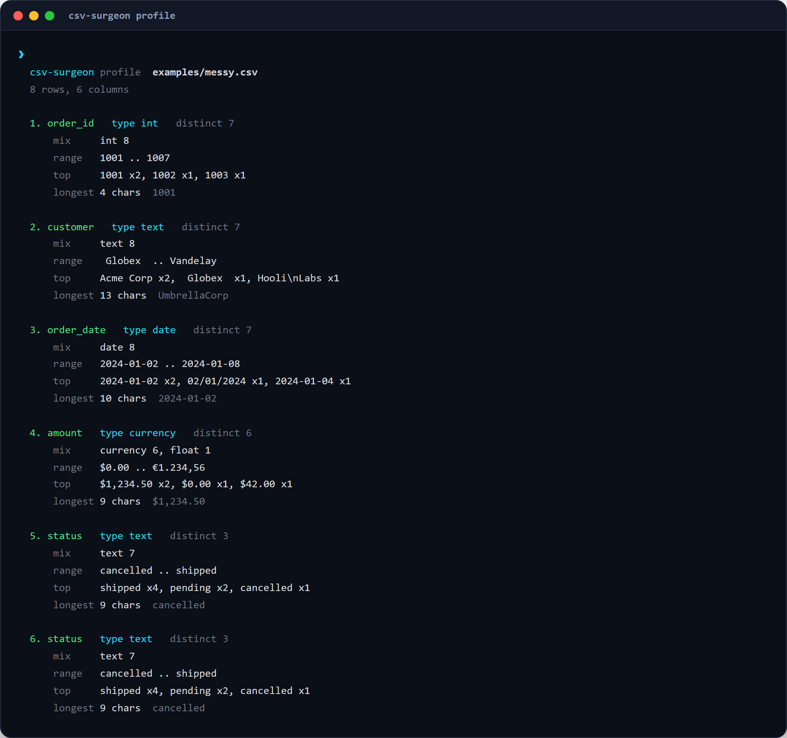
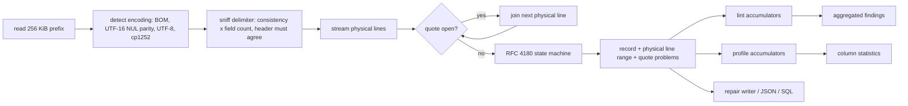

# csv-surgeon

**English** | [简体中文](README.zh-CN.md)

**Find the twelve things wrong with an Excel CSV in one pass, then fix the six that are safe to fix.**

[](https://github.com/kele-tao/csv-surgeon/actions/workflows/ci.yml)






## The problem

A CSV that Excel saved is rarely the CSV your loader expects. It starts with a
byte order mark that becomes part of the first column name. It uses `;` because
the machine is German, and `1.234,56` because so is the accountant. One customer
name has a zero-width space in it, so the join silently drops a row. Two rows are
ragged, one quote is stray, and the same order appears twice.

None of this raises an error. It produces a dashboard that is quietly wrong.
`csv-surgeon` audits the file against 15 documented rule codes, profiles every
column, and repairs only what can be repaired without inventing data.

## What it does

- **`lint`** - one streaming pass, 15 rule codes (`CS001`-`CS015`), every finding
  with a severity, a physical line number, a column name and up to five real
  examples. Exit code 1 when anything at or above `--fail-on` is found, so it
  drops straight into CI.
- **`profile`** - per column: type mix, null spellings (`""`, `NULL`, `N/A`, `-`),
  distinct count, top 10 values, numeric and chronological ranges, longest value,
  and groups of values that differ only by case or spacing.
- **`repair`** - nine safe fixes (BOM, line endings, headers, trim, zero-width,
  control characters, canonical quoting, blank rows, duplicate rows). Dry run by
  default; every change is written to a machine-readable JSON change log.
- **`to-json`** / **`to-sql`** - streaming export, with column-wide SQL type
  inference (`INTEGER`, `DOUBLE PRECISION`, `DATE`, `TIMESTAMP`, `TEXT`) and
  batched `INSERT`s.
- **`rules`** - the rule reference as a table or as JSON.

Everything is stdlib-only, streams in constant memory, and produces byte-identical
output for identical input.

## Install

Not on PyPI yet - install from source:

```bash
git clone https://github.com/kele-tao/csv-surgeon
cd csv-surgeon
pip install -e .

# or with the development tooling (pytest, ruff)
pip install -e ".[dev]"
```

Requires Python 3.10 or newer. No runtime dependencies.

## Usage

### 1. Audit a file you were sent

```console
$ python -m csv_surgeon lint examples/messy.csv

  csv-surgeon lint  examples/messy.csv

  rows        8
  columns     6
  encoding    utf-8 with BOM
  delimiter   semicolon
  newlines    mixed

  SEVERITY  RULE   INSTANCES  FINDING
  ERROR     CS003  -          1 RFC 4180 quote violation(s)
            line 8  column customer: quote character inside an unquoted field
  ERROR     CS004  -          1 of 8 data rows have the wrong field count
            line 9  3 fields, header has 6
  WARN      CS001  -          1 duplicate header name(s)
            line 1  columns 5 and 6 are both 'status'
  WARN      CS006  -          mixed line endings: 9 CRLF, 1 LF
  WARN      CS007  -          column 2 (customer): 1 value(s) with untrimmed whitespace
  WARN      CS008  -          column 2 (customer): 1 value(s) contain zero-width characters
  WARN      CS010  x8         column 3 (order_date): 3 date formats (DMY_SLASH_OR_MDY x1, ISO x6, MON_NAME x1)
  WARN      CS011  x7         column 4 (amount): conflicting decimal conventions (dot_decimal, dot_thousands, comma_thousands)
  WARN      CS012  -          1 duplicate row(s) of 8
            line 10  1001 | Acme Corp | 2024-01-02 | $1,234.50 | shipped | shipp...
  INFO      CS005  -          file starts with a utf-8 with BOM byte order mark
  INFO      CS013  -          1 record(s) contain an embedded newline
            line 6  record spans lines 6-7

  2 error   7 warn   2 info   24 instances in 8 rows
  next: run repair with --fix for the 6 fixable rule(s)
```

The same data as JSON, for a dashboard or a CI artefact:

```console
$ python -m csv_surgeon lint examples/messy.csv --json | head -18
{
  "path": "examples/messy.csv",
  "encoding": "utf-8 with BOM",
  "delimiter": ";",
  "newlines": "mixed",
  "rows": 8,
  "columns": 6,
  "counts": {
    "error": 2,
    "warn": 7,
    "info": 2,
    "instances": 24
  },
  "findings": [
    {
      "code": "CS003",
      "severity": "error",
...
```

### 2. Understand a column before you load it

```console
$ python -m csv_surgeon profile examples/messy.csv --top 3

  csv-surgeon profile  examples/messy.csv
  8 rows, 6 columns

  1. order_id   type int   distinct 7
      mix     int 8
      range   1001 .. 1007
      top     1001 x2, 1002 x1, 1003 x1
      longest 4 chars  1001

  2. customer   type text   distinct 7
      mix     text 8
      range    Globex  .. Vandelay
      top     Acme Corp x2,  Globex  x1, Hooli\nLabs x1
      longest 13 chars  UmbrellaCorp

  4. amount   type currency   distinct 6
      mix     currency 6, float 1
      range   $0.00 .. EUR 1.234,56
      top     $1,234.50 x2, $0.00 x1, $42.00 x1
      longest 9 chars  $1,234.50
```

### 3. Repair, review the diff, ship it

`repair` is a dry run unless `--out` is given, so it is safe to run on the
original file. This is the real output for the bundled example:

```console
$ python -m csv_surgeon repair examples/messy.csv --fix all --out clean.csv --log change-log.json

  csv-surgeon repair  examples/messy.csv  (writing clean.csv)
  fixes: bom, newline, header, trim, zero-width, control, quotes, blank-rows, dedupe

  CHANGE      COUNT
  bom             1
  dedupe          1
  header          1
  newline        10
  quotes          1
  trim            1
  zero-width      1

  line 1     header      order_id | customer | order_date | amount | status | status -> order_id | ... | status_2
  line 3     trim        1002 |  Globex  | 02/01/2024 | $99.00 | pending | pending -> 1002 | Globex | ...
  line 5     zero-width  1004 | UmbrellaCorp | 2024-01-04 | 1,234.56 | cancelled | ...

  wrote clean.csv (7 rows)
```

The actual diff, produced by `difflib` on the two files (also committed as
[docs/repair-diff.txt](docs/repair-diff.txt)):

```diff
--- examples/messy.csv
+++ docs/sample-clean.csv
@@ -1 +1 @@
-order_id;customer;order_date;amount;status;status
+order_id;customer;order_date;amount;status;status_2
@@ -3 +3 @@
-1002; Globex ;02/01/2024;$99.00;pending;pending
+1002;Globex;02/01/2024;$99.00;pending;pending
@@ -5 +5 @@
-1004;Umbrella​Corp;2024-01-04;1,234.56;cancelled;cancelled
+1004;UmbrellaCorp;2024-01-04;1,234.56;cancelled;cancelled
@@ -8 +8 @@
-1006;Soylent "Co;2024-01-07;$42.00;pending;pending
+1006;"Soylent ""Co";2024-01-07;$42.00;pending;pending
@@ -10 +9,0 @@
-1001;Acme Corp;2024-01-02;$1,234.50;shipped;shipped
```

Note what did **not** change: the delimiter stayed `;`, the date strings and the
`EUR 1.234,56` amount were left exactly as they were. Deciding that `02/01/2024`
means 2 January requires a decision about the file's locale, and `repair` does
not guess. `lint` reports it as `CS010`; rewriting dates is on the roadmap.
### 4. Export

```console
$ python -m csv_surgeon to-sql examples/messy.csv --table orders
CREATE TABLE orders (
    order_id INTEGER NOT NULL,
    customer TEXT NOT NULL,
    order_date DATE NOT NULL,
    amount DOUBLE PRECISION NOT NULL,
    status TEXT NOT NULL,
    status_2 TEXT NOT NULL
);
INSERT INTO orders (order_id, customer, order_date, amount, status, status_2) VALUES
(1001, 'Acme Corp', '2024-01-02', 1234.5, 'shipped', 'shipped'),
(1002, 'Globex', '2024-01-02', 99.0, 'pending', 'pending'),
...
(1007, 'Vandelay', '2024-01-08', NULL, NULL, NULL);
```

`to-json` streams a JSON array of objects instead, and both commands accept
`--out FILE` to write to disk.

## Rule reference

Every finding has one of these codes. `lint --json` emits the same codes, so a
CI job can fail on a specific rule.

| Code | Severity | Fixable | Check |
| --- | --- | --- | --- |
| `CS001` | warn | yes | Duplicate header name |
| `CS002` | warn | yes | Blank or padded header |
| `CS003` | error | no | RFC 4180 quote violation (stray quote, text after close) |
| `CS004` | error | no | Ragged row: field count differs from the header |
| `CS005` | info | yes | Byte order mark present |
| `CS006` | info | yes | CRLF/CR or mixed line endings |
| `CS007` | warn | yes | Leading or trailing whitespace in values |
| `CS008` | warn | yes | Invisible zero-width characters |
| `CS009` | error | yes | C0/DEL control characters |
| `CS010` | warn | no | Mixed date formats in one column |
| `CS011` | warn | no | Ambiguous or conflicting number formats |
| `CS012` | warn | yes | Duplicate rows |
| `CS013` | info | no | Embedded newline inside a quoted field |
| `CS014` | warn | yes | Unicode normalisation mismatch (NFC vs NFD) |
| `CS015` | info | no | Near-duplicate values (case/space variants) |

`python -m csv_surgeon rules` prints this table; `--json` emits it as JSON.

## How it works



**The parser is the product.** Python's `csv` module is fast and correct, but it
hides the raw text of a record, and a linter that cannot say "line 8, column
`customer`" is not worth running. So `csv_surgeon.csvio` implements a small
RFC 4180 state machine over a universal-newline text stream. It yields one
`Record` at a time, together with the physical line range it occupied and any
quote violations, and it never holds more than one record (capped at 16 MiB).

**Detection is a score, not a guess.** Delimiters are scored by
`consistency x field count`, with a bonus when the header row agrees, because a
plain "count the commas" heuristic reads `1,234.56` as two columns. Encodings go
through BOM, then a UTF-16 NUL-parity check, then strict UTF-8, then a
windows-1252 round trip - in that order, because UTF-16 is valid bytes but not
valid text.

**Repairs are only what is provably safe.** Nine repairs ship, and each one is a
pure function of a cell: strip a BOM, normalise line endings, trim, drop invisible
characters, re-emit canonical quoting, remove rows that are byte-identical to an
earlier row. Nothing that requires knowing what the data *means* is repaired.

## Design decisions

1. **Stdlib only, and a hand-written parser.** `pandas.read_csv` would solve 60%
   of this in one line and then hide the other 40%: it does not report line
   numbers, it cannot tell you that row 8 has a stray quote, and importing it
   costs 40 MB and a second of start-up. `csv` stays fast for the common case:
   any physical line without a quote is split directly, and only quoted or
   multi-line records go through the state machine.
2. **Aggregate findings, cap the indexes.** A 10-million-row export must not
   produce 10 million findings or a 2 GB set of hashes. Findings are aggregated
   per (rule, column) with up to five examples; the duplicate index stops at
   200,000 rows and the distinct index at 50,000 values, and the report says so
   explicitly rather than quietly returning a wrong number.
3. **Dry run by default, never overwrite.** `repair` writes nothing without
   `--out`, refuses to write onto its own input, preserves the input delimiter,
   and records every change in a JSON log. A data-cleaning tool that surprises
   you once is a tool you never run again.

## Performance

The numbers below come from `python benchmarks/run.py`, which generates a
deterministic 5 MB file (111,844 rows, BOM, CRLF, three date formats, currency
amounts) and times each command. Full table in [benchmarks/RESULTS.md](benchmarks/RESULTS.md).

| Operation | Runtime | Throughput | Rows/s | Peak Python alloc |
| --- | ---: | ---: | ---: | ---: |
| `lint` | 3.2 s | 1.5 MB/s | 34,615 | 19.8 MB |
| `profile` | 9.1 s | 0.5 MB/s | 12,242 | 20.6 MB |
| `repair` (dry run) | 2.6 s | 1.9 MB/s | 43,099 | 13.2 MB |

Peak allocation is measured with `tracemalloc`; it is driven by the capped
distinct/duplicate indexes, not by the row count. Reproduce with:

```bash
python benchmarks/run.py --mb 5 --repeat 3    # the table above
python benchmarks/run.py --mb 250            # memory flatness check
```

Honest caveat: 1.5 MB/s is slow next to a C parser, because every cell is
classified (date? number? which date format?). `profile` is the slowest command
because it keeps distinct-value and near-duplicate indexes.

## Comparison

| | csv-surgeon | `csvkit` (`csvclean`, `csvstat`) | `pandas.read_csv` |
| --- | --- | --- | --- |
| Reports a line and column for a quote violation | yes (`CS003`) | partial | no |
| Encoding detection | BOM, UTF-16, UTF-8, cp1252 | chardet-based | relies on chardet |
| Locale-ambiguous numbers (`1.234` vs `1,234.56`) | reported (`CS011`) | no | parsed silently |
| Mixed date formats in a column | reported (`CS010`) | no | parsed or `object` |
| Repairs with a change log and a dry run | yes | `csvclean` fixes field counts only | no |
| Streaming constant memory | yes | yes | no (`read_csv` is whole-file) |
| Dependencies | none | many | numpy + pandas (~40 MB) |
| Column profiling | yes | `csvstat` (better: quartiles, type inference) | yes (best) |

`csvstat` profiles more statistically than `profile` does; `pandas` gives you a
DataFrame that a C parser fills in seconds. Use those when that is what you want.
`csv-surgeon` exists for the audit before the load: what is wrong with this file,
where exactly, and what may I safely change.

## Roadmap

1. **Locale-aware date rewriting** (`--date-locale dmy`) so `02/01/2024` can be
   normalised once the user states the convention. Deliberately omitted from v1:
   a wrong guess silently corrupts data.
2. **Ragged-row repair with a schema contract** - pad or reject, never guess which
   column was dropped.
3. **JSONL input** through an optional extra, keeping the core stdlib-only.
4. **HTML report** rendered from `--json`, for people who will not read a terminal.
5. **Multi-file / directory linting** with a per-repository summary (the CLI is
   single-file today).

## Exit codes

| Code | Meaning |
| --- | --- |
| 0 | Success, or no findings at the requested `--fail-on` threshold |
| 1 | The lint gate failed (`--fail-on error` is the default) |
| 2 | Usage error: unknown flag, missing file, unreadable input |

## Contributing

Issues and pull requests are welcome. Run `pytest -q` and `ruff check .` before
opening one; see [CONTRIBUTING.md](CONTRIBUTING.md) for the rule-adding
checklist and [SECURITY.md](SECURITY.md) for the threat model.

## License

MIT (c) 2026 kele. See [LICENSE](LICENSE).
