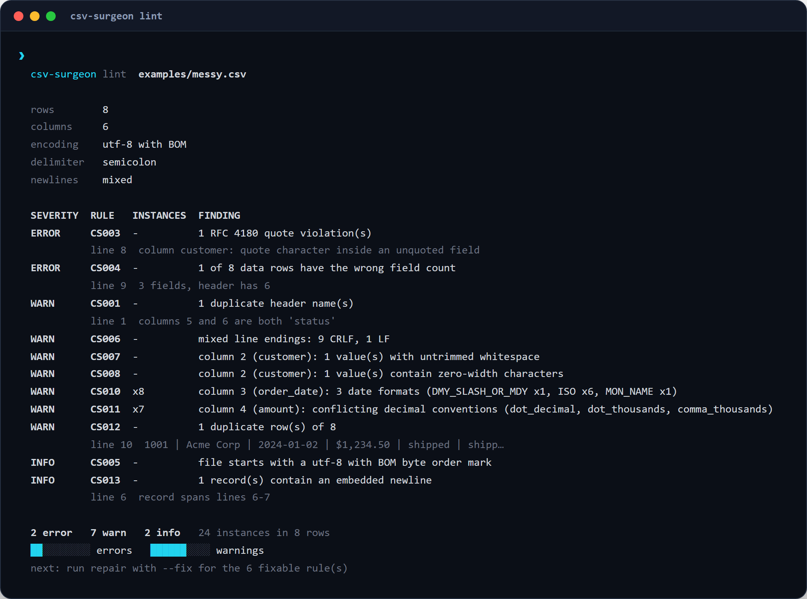
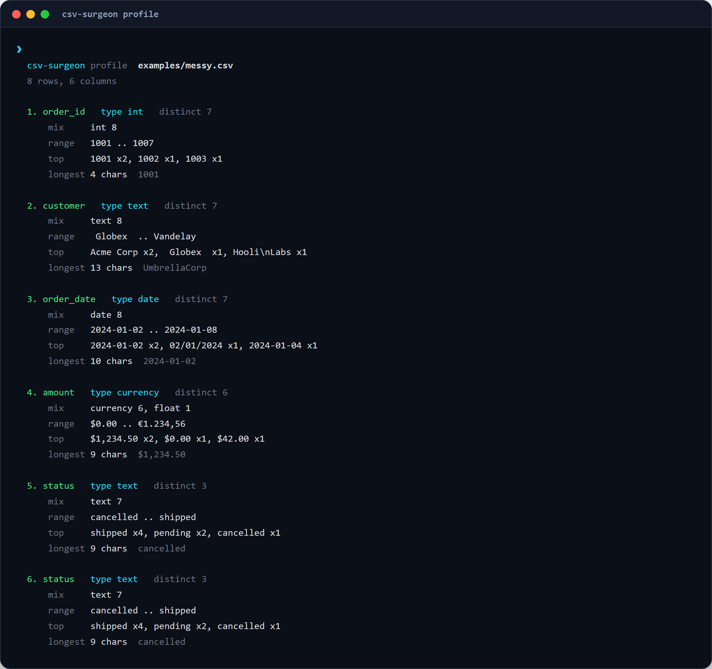
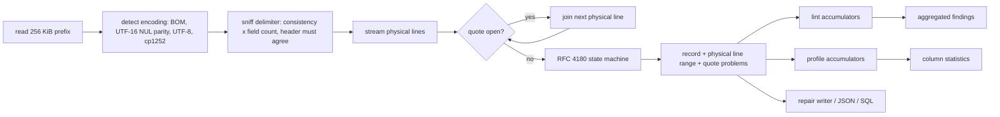

# csv-surgeon

[English](README.md) | **简体中文**

**一次扫描找出 Excel 导出的 CSV 里那十二处问题，然后修掉其中六处可以安全修复的。**

[](https://github.com/kele-tao/csv-surgeon/actions/workflows/ci.yml)






## 问题

Excel 存出来的 CSV，很少是加载器期望的那种 CSV。它开头带一个字节序标记（BOM），
这个标记最后变成了第一个列名的一部分。它用 `;` 作分隔符，因为这台机器是
德语环境；金额写成 `1.234,56`，因为会计的习惯也是德语的。某个客户名里藏着一个
零宽空格，于是做 join 的时候悄悄掉了一行。有两行字段数对不上，有一处引号是多余的，
同一笔订单还出现了两次。

这些没有一处会报错。它产出的是一张看上去正常、实则悄悄算错的仪表盘。`csv-surgeon`
用 15 条有据可查的规则码审计文件，为每一列做画像，并且只修复那些不编造数据就能修的
地方。

## 它能做什么

- **`lint`** —— 一次流式扫描，15 条规则码（`CS001`-`CS015`），每条发现都带严重级别、
  物理行号、列名，最多再附五条真实样例。只要出现达到或高于 `--fail-on` 级别的发现，
  退出码就是 1，因此可以直接接进 CI。
- **`profile`** —— 按列给出：类型构成、空值的写法（`""`、`NULL`、`N/A`、`-`）、
  去重取值个数、前 10 个高频值、数值与时间范围、最长的取值，以及仅大小写或空格不同的
  一组近似同值。
- **`repair`** —— 九种安全修复（BOM、换行符、表头、首尾空白、零宽字符、控制字符、
  规范化引号、空行、重复行）。默认 dry run，每一处改动都写进机器可读的 JSON 变更日志。
- **`to-json`** / **`to-sql`** —— 流式导出，按整列推断 SQL 类型
  （`INTEGER`、`DOUBLE PRECISION`、`DATE`、`TIMESTAMP`、`TEXT`），并批量 `INSERT`。
- **`rules`** —— 以表格或 JSON 形式输出规则参考。

全部只用标准库，常量内存流式处理，相同输入产生逐字节一致的输出。

## 安装

尚未发布到 PyPI，请从源码安装：

```bash
git clone https://github.com/kele-tao/csv-surgeon
cd csv-surgeon
pip install -e .

# or with the development tooling (pytest, ruff)
pip install -e ".[dev]"
```

需要 Python 3.10 或更高版本。没有运行时依赖。

## 用法

### 1. 审计一个别人发来的文件

```console
$ python -m csv_surgeon lint examples/messy.csv

  csv-surgeon lint  examples/messy.csv

  rows        8
  columns     6
  encoding    utf-8 with BOM
  delimiter   semicolon
  newlines    mixed

  SEVERITY  RULE   INSTANCES  FINDING
  ERROR     CS003  -          1 RFC 4180 quote violation(s)
            line 8  column customer: quote character inside an unquoted field
  ERROR     CS004  -          1 of 8 data rows have the wrong field count
            line 9  3 fields, header has 6
  WARN      CS001  -          1 duplicate header name(s)
            line 1  columns 5 and 6 are both 'status'
  WARN      CS006  -          mixed line endings: 9 CRLF, 1 LF
  WARN      CS007  -          column 2 (customer): 1 value(s) with untrimmed whitespace
  WARN      CS008  -          column 2 (customer): 1 value(s) contain zero-width characters
  WARN      CS010  x8         column 3 (order_date): 3 date formats (DMY_SLASH_OR_MDY x1, ISO x6, MON_NAME x1)
  WARN      CS011  x7         column 4 (amount): conflicting decimal conventions (dot_decimal, dot_thousands, comma_thousands)
  WARN      CS012  -          1 duplicate row(s) of 8
            line 10  1001 | Acme Corp | 2024-01-02 | $1,234.50 | shipped | shipp...
  INFO      CS005  -          file starts with a utf-8 with BOM byte order mark
  INFO      CS013  -          1 record(s) contain an embedded newline
            line 6  record spans lines 6-7

  2 error   7 warn   2 info   24 instances in 8 rows
  next: run repair with --fix for the 6 fixable rule(s)
```

同样的数据以 JSON 输出，方便接仪表盘或留作 CI 产物：

```console
$ python -m csv_surgeon lint examples/messy.csv --json | head -18
{
  "path": "examples/messy.csv",
  "encoding": "utf-8 with BOM",
  "delimiter": ";",
  "newlines": "mixed",
  "rows": 8,
  "columns": 6,
  "counts": {
    "error": 2,
    "warn": 7,
    "info": 2,
    "instances": 24
  },
  "findings": [
    {
      "code": "CS003",
      "severity": "error",
...
```

### 2. 加载之前先看懂一列

```console
$ python -m csv_surgeon profile examples/messy.csv --top 3

  csv-surgeon profile  examples/messy.csv
  8 rows, 6 columns

  1. order_id   type int   distinct 7
      mix     int 8
      range   1001 .. 1007
      top     1001 x2, 1002 x1, 1003 x1
      longest 4 chars  1001

  2. customer   type text   distinct 7
      mix     text 8
      range    Globex  .. Vandelay
      top     Acme Corp x2,  Globex  x1, Hooli\nLabs x1
      longest 13 chars  UmbrellaCorp

  4. amount   type currency   distinct 6
      mix     currency 6, float 1
      range   $0.00 .. EUR 1.234,56
      top     $1,234.50 x2, $0.00 x1, $42.00 x1
      longest 9 chars  $1,234.50
```

### 3. 修复、审 diff、发出去

没有给 `--out` 时 `repair` 是 dry run，所以对着原始文件跑是安全的。下面是仓库
自带示例的真实输出：

```console
$ python -m csv_surgeon repair examples/messy.csv --fix all --out clean.csv --log change-log.json

  csv-surgeon repair  examples/messy.csv  (writing clean.csv)
  fixes: bom, newline, header, trim, zero-width, control, quotes, blank-rows, dedupe

  CHANGE      COUNT
  bom             1
  dedupe          1
  header          1
  newline        10
  quotes          1
  trim            1
  zero-width      1

  line 1     header      order_id | customer | order_date | amount | status | status -> order_id | ... | status_2
  line 3     trim        1002 |  Globex  | 02/01/2024 | $99.00 | pending | pending -> 1002 | Globex | ...
  line 5     zero-width  1004 | UmbrellaCorp | 2024-01-04 | 1,234.56 | cancelled | ...

  wrote clean.csv (7 rows)
```

真正的 diff 由 `difflib` 对这两个文件生成（同样提交在
[docs/repair-diff.txt](docs/repair-diff.txt)）：

```diff
--- examples/messy.csv
+++ docs/sample-clean.csv
@@ -1 +1 @@
-order_id;customer;order_date;amount;status;status
+order_id;customer;order_date;amount;status;status_2
@@ -3 +3 @@
-1002; Globex ;02/01/2024;$99.00;pending;pending
+1002;Globex;02/01/2024;$99.00;pending;pending
@@ -5 +5 @@
-1004;Umbrella​Corp;2024-01-04;1,234.56;cancelled;cancelled
+1004;UmbrellaCorp;2024-01-04;1,234.56;cancelled;cancelled
@@ -8 +8 @@
-1006;Soylent "Co;2024-01-07;$42.00;pending;pending
+1006;"Soylent ""Co";2024-01-07;$42.00;pending;pending
@@ -10 +9,0 @@
-1001;Acme Corp;2024-01-02;$1,234.50;shipped;shipped
```

注意哪些东西**没有**变：分隔符仍然是 `;`，日期字符串和 `EUR 1.234,56` 金额都原封
不动。要判定 `02/01/2024` 指的是 2024 年 1 月 2 日，得先对文件所处的 locale 做一个
决定，而 `repair` 不做这种猜测。`lint` 会把它报成 `CS010`；改写日期在路线图上。

### 4. 导出

```console
$ python -m csv_surgeon to-sql examples/messy.csv --table orders
CREATE TABLE orders (
    order_id INTEGER NOT NULL,
    customer TEXT NOT NULL,
    order_date DATE NOT NULL,
    amount DOUBLE PRECISION NOT NULL,
    status TEXT NOT NULL,
    status_2 TEXT NOT NULL
);
INSERT INTO orders (order_id, customer, order_date, amount, status, status_2) VALUES
(1001, 'Acme Corp', '2024-01-02', 1234.5, 'shipped', 'shipped'),
(1002, 'Globex', '2024-01-02', 99.0, 'pending', 'pending'),
...
(1007, 'Vandelay', '2024-01-08', NULL, NULL, NULL);
```

`to-json` 改为流式输出一个对象数组形式的 JSON，两个命令都接受 `--out FILE` 写盘。

## 规则参考

每条发现都带下列规则码之一。`lint --json` 输出的也是同一套规则码，所以 CI 可以
针对某一条具体规则判定失败。

| 规则码 | 严重级别 | 可修复 | 检查内容 |
| --- | --- | --- | --- |
| `CS001` | warn | 是 | 表头重名 |
| `CS002` | warn | 是 | 表头为空或带填充空白 |
| `CS003` | error | 否 | RFC 4180 引号错误（多余引号、闭合引号后还有文本） |
| `CS004` | error | 否 | 错行：字段数与表头不一致 |
| `CS005` | info | 是 | 存在字节序标记（BOM） |
| `CS006` | info | 是 | CRLF/CR 或混合换行 |
| `CS007` | warn | 是 | 取值首尾带空白 |
| `CS008` | warn | 是 | 不可见的零宽字符 |
| `CS009` | error | 是 | C0/DEL 控制字符 |
| `CS010` | warn | 否 | 同一列内日期格式混用 |
| `CS011` | warn | 否 | 数字格式歧义或冲突 |
| `CS012` | warn | 是 | 重复行 |
| `CS013` | info | 否 | 引号字段内嵌换行 |
| `CS014` | warn | 是 | Unicode 规范化不一致（NFC 与 NFD） |
| `CS015` | info | 否 | 近似同值（仅大小写或空格不同） |

`python -m csv_surgeon rules` 会打印这张表；加 `--json` 则以 JSON 输出。

## 工作原理



**解析器本身就是产品。** Python 的 `csv` 模块又快又正确，但它把一条记录的原始文本
藏了起来；而一个说不出「第 8 行、`customer` 列」的检查器，不值得跑。于是
`csv_surgeon.csvio` 在统一换行符的文本流上实现了一个小型的 RFC 4180 状态机。它一次
产出一条 `Record`，同时给出这条记录占用的物理行范围以及任何引号问题，并且始终只
持有一条记录（上限 16 MiB）。

**检测是打分，不是猜测。** 分隔符按「一致性 × 字段数」打分，表头行一致时额外加分，
因为单纯「数逗号」的启发式会把 `1,234.56` 读成两列。编码依次过 BOM、UTF-16 的
NUL 奇偶校验、严格 UTF-8、windows-1252 往返检查，顺序如此是因为 UTF-16 的字节合法、
文本不合法。

**只做可证明安全的修复。** 一共九种修复，每一种都是对单个单元格的纯函数：去掉 BOM、
统一换行符、去首尾空白、删掉不可见字符、按规范重新输出引号、删除与前面某行逐字节
相同的行。凡是需要理解数据**含义**才能做的修复，一律不做。

## 设计取舍

1. **只用标准库，解析器手写。** `pandas.read_csv` 一行就能解决这里 60% 的问题，然后
   把另外 40% 藏起来：它不报行号，说不出第 8 行有个多余引号，而导入它的代价是 40 MB
   内存外加一秒启动时间。`csv` 在常见路径上依然快：任何不含引号的物理行直接切分，
   只有带引号或跨行的记录才进状态机。
2. **聚合发现，给索引设上限。** 一次千万行的导出不能产出千万条发现，也不能建一个 2 GB
   的哈希集合。发现按（规则，列）聚合，每组最多五条样例；重复行索引在 200,000 行处
   封顶，去重索引在 50,000 个值处封顶，报告会明确写出这一点，而不是悄悄返回一个错误
   的数字。
3. **默认 dry run，绝不覆盖。** 没有 `--out` 时 `repair` 一个字都不写，拒绝写到自己
   的输入上，保留输入的分隔符，并把每一处改动记进 JSON 日志。一个曾经让你意外一次的
   数据清洗工具，你永远不会再跑第二次。

## 性能

下面的数字来自 `python benchmarks/run.py`：它生成一个确定性的 5 MB 文件
（111,844 行，带 BOM、CRLF、三种日期格式、货币金额），并对每个命令计时。
完整表格见 [benchmarks/RESULTS.md](benchmarks/RESULTS.md)。

| 操作 | 耗时 | 吞吐 | 行/秒 | Python 峰值分配 |
| --- | ---: | ---: | ---: | ---: |
| `lint` | 3.2 s | 1.5 MB/s | 34,615 | 19.8 MB |
| `profile` | 9.1 s | 0.5 MB/s | 12,242 | 20.6 MB |
| `repair`（dry run） | 2.6 s | 1.9 MB/s | 43,099 | 13.2 MB |

峰值分配用 `tracemalloc` 测量，它由设了上限的去重/重复索引决定，而不由行数决定。
复现方式：

```bash
python benchmarks/run.py --mb 5 --repeat 3    # the table above
python benchmarks/run.py --mb 250            # memory flatness check
```

一句老实话：1.5 MB/s 放在 C 解析器旁边是慢的，因为每个单元格都要分类（是日期吗？
是数字吗？是哪一种日期格式？）。`profile` 是最慢的命令，因为它要维护去重值和
近似重复值的索引。

## 对比

| | csv-surgeon | `csvkit`（`csvclean`、`csvstat`） | `pandas.read_csv` |
| --- | --- | --- | --- |
| 为引号错误报出行号与列名 | 是（`CS003`） | 部分 | 否 |
| 编码检测 | BOM、UTF-16、UTF-8、cp1252 | 基于 chardet | 依赖 chardet |
| locale 歧义数字（`1.234` 与 `1,234.56`） | 报告（`CS011`） | 否 | 静默解析 |
| 一列内日期格式混用 | 报告（`CS010`） | 否 | 解析成日期或 `object` |
| 带变更日志和 dry run 的修复 | 是 | `csvclean` 只修字段数 | 否 |
| 流式常量内存 | 是 | 是 | 否（`read_csv` 是整文件读） |
| 依赖 | 无 | 多 | numpy + pandas（约 40 MB） |
| 列画像 | 是 | `csvstat`（更强：四分位数、类型推断） | 是（最强） |

`csvstat` 的画像比 `profile` 更有统计深度；`pandas` 给你的是一个由 C 解析器
几秒内填满的 DataFrame。你想要的正是这些，那就用它们。`csv-surgeon` 存在的意义是
加载之前的那次审计：这个文件哪里有问题、具体在哪儿、哪些是我可以安全改的。

## 路线图

1. **按 locale 改写日期**（`--date-locale dmy`），这样在用户声明约定之后，
   `02/01/2024` 就可以被规范化。这一项刻意没有放进 v1：猜错会静默污染数据。
2. **带模式（schema）契约的错行修复** —— 补齐或拒绝，绝不去猜是哪一列丢了。
3. **JSONL 输入**，通过可选 extra 提供，核心仍然只依赖标准库。
4. **HTML 报告**，从 `--json` 渲染，给那些不愿意读终端的人。
5. **多文件 / 目录级 lint**，附按仓库汇总（目前的 CLI 一次只处理一个文件）。

## 退出码

| 退出码 | 含义 |
| --- | --- |
| 0 | 成功，或没有达到所请求的 `--fail-on` 阈值的发现 |
| 1 | lint 门禁失败（`--fail-on error` 是默认值） |
| 2 | 用法错误：未知 flag、文件缺失、输入不可读 |

## 参与贡献

欢迎提 issue 和 pull request。提交之前请先跑 `pytest -q` 和 `ruff check .`；新增规则
的检查清单见 [CONTRIBUTING.md](CONTRIBUTING.md)，威胁模型见 [SECURITY.md](SECURITY.md)。

## 许可证

MIT (c) 2026 kele。见 [LICENSE](LICENSE)。
